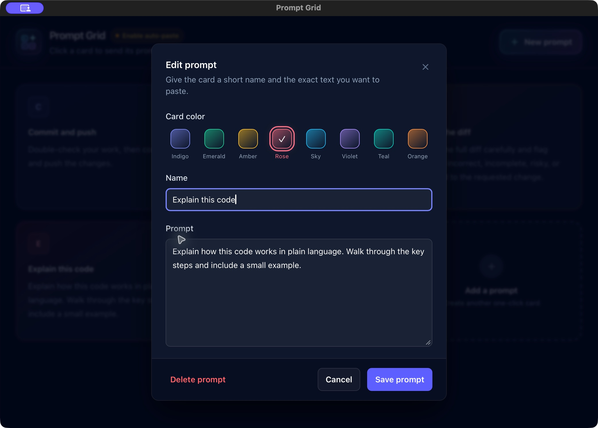

# Prompt Grid

A local macOS companion for keeping reusable prompts beside Codex. Click a card
to copy it, or switch to Codex and paste into its focused field. Prompt Grid
never presses Return or submits the prompt.

**0.1.0 · macOS 14+ · Universal Apple Silicon / Intel build**


Independent software, not affiliated with or endorsed by OpenAI. Automatic
pasting requires the Codex desktop app and a Mac supported by that app.
Prompt Grid's universal binary does not change Codex's system requirements.

## Download

1. Open the [latest release](https://github.com/brentscholl/prompt-grid/releases/latest) and download
   `Prompt-Grid-0.1.0-macOS-universal-unsigned.zip` from the assets.
   GitHub's **Source code** archives are for developers.
2. Unzip and move **Prompt Grid.app** into **Applications** before opening it.
3. Open the app. No Node.js, terminal, developer tools, API key, or account is
   required to run Prompt Grid.

This release is ad-hoc signed, **not Developer ID signed or notarized by Apple**.
macOS may block its first launch. If you trust the download, follow Apple's
[first-open instructions](https://support.apple.com/102445): after trying to open
it, use **System Settings → Privacy & Security → Open Anyway**. Managed Macs may
prevent this. Do not disable Gatekeeper or SIP globally.

The adjacent `.sha256` file checks download integrity; it is not proof of a
trusted publisher or notarization.

## Enable pasting

1. Click **Enable auto-paste** in Prompt Grid.
2. Enable **Prompt Grid** in **System Settings → Privacy & Security → Accessibility**.
3. Open Codex and click its composer, then click a Prompt Grid card.

Without permission, cards still copy for manual pasting. This app targets the
Codex desktop app, not a browser or terminal. It sends Command-V to whichever
field Codex has focused, so focus the composer first. Wait for each paste to
finish before clicking the next card; overlapping clicks can supersede the
earlier paste. Each copied prompt ends in a space.

## Features

- Create, edit, and delete cards. Pick one of eight persistent card colors.
- Drag a card or its move handle. Cards slide aside to preview the drop.
- Release to save the order; Escape cancels a drag or closes the editor.
- Command-N creates a prompt. Deletion requires confirmation.

### Make each prompt your own

Give a card a name, write the text to paste, and choose its color.



Screenshots use generic demo prompts in a separate app profile. Fresh installs
start with three example cards; you can add your own.

## Privacy and saved data

Prompt Grid makes no network requests and has no analytics. Cards, order, and
colors are stored in WebKit local storage on your Mac. Fresh installs get three
generic examples. Your saved prompts are never bundled in the app or source.

Selected text goes on the system clipboard, where other apps or clipboard
managers may read it. Auto-paste sends it to Codex; submission is governed by
Codex and your account settings. Accessibility is used to send Command-V.
Prompt Grid does not read Codex conversations or credentials.

There is no cloud sync or export/import yet. Keep a separate copy of important
prompts. Clearing app/WebKit data can remove saved cards.

## Updates and troubleshooting

Quit the app and replace it in the **same Applications location**, then reopen.
Back up important prompts before updating; do not remove app data. Unsigned
updates can require refreshing Accessibility: remove its old entry, add the
newly installed app, and enable it. Focus the Codex composer again.

**Focus Codex first** means Prompt Grid needs to see Codex become active.
**Sent paste to Codex** confirms the keystroke was sent, not receipt by Codex.
If nothing appears, focus an editable composer and use Command-V manually.

## Build from source

Use macOS, Xcode Command Line Tools (`xcode-select --install`), and Node.js 22+.

```sh
npm ci
npm test
npm run build
```

The app uses Swift/AppKit and a bundled WebKit interface with Tailwind CSS.
The build explicitly targets macOS 14, builds arm64 and x86_64, and combines
them into `dist/Prompt Grid.app`. Node.js is not shipped with the app.
The OS floor includes the WebKit support required by
[Tailwind v4](https://tailwindcss.com/docs/compatibility).

`npm run release` creates the ZIP and checksum. GitHub Actions runs the same
checks and uploads artifacts without publishing a release automatically.
See [RELEASING.md](RELEASING.md) for manual verification and publishing.

## License

MIT. See [LICENSE](LICENSE) and [THIRD_PARTY_NOTICES.md](THIRD_PARTY_NOTICES.md).
